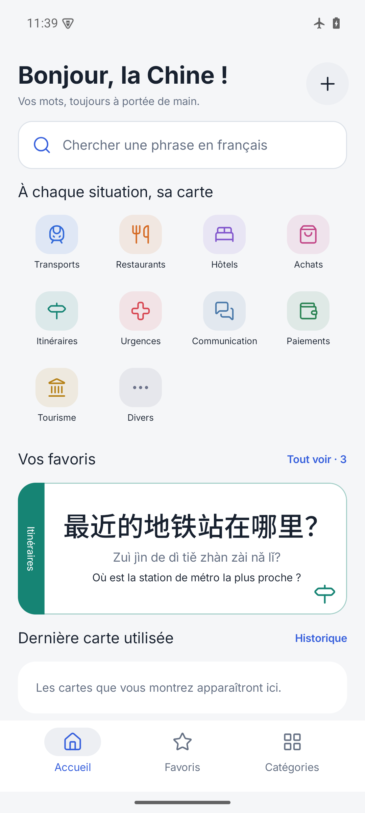
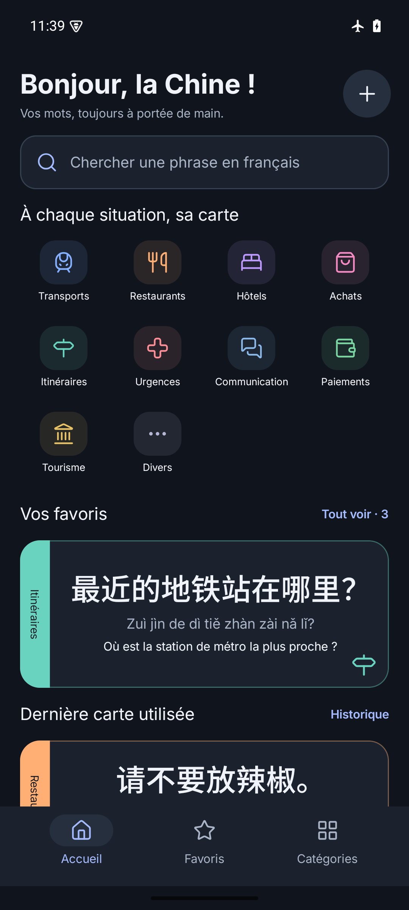
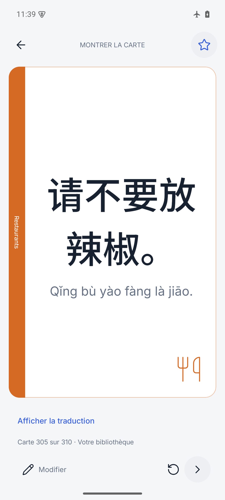

# Shuo · Offline Chinese travel cards

Shuo is an Android phrasebook for travelers in China. Find a phrase, show it in
large simplified Chinese, and keep your own travel cards available offline.
The interface and all 310 bundled cards support **French, English, Spanish, and
Italian**, alongside tone-marked pinyin. French is the default; your language
choice is saved on the device.

**Android 8.0+ · Version 0.2.0 · Offline phrasebook · Optional GitHub updates**

| Home · light | Home · dark | Presentation |
| --- | --- | --- |
|  |  |  |

## Features

- Search in French, English, Spanish, Italian, Chinese, pinyin, and keywords, ignoring accents and tones. Joined pinyin such as `xishoujian` also works.
- Browse categories, save favorites, and return to recently presented cards.
- Present Chinese and pinyin in large type, reveal translations when needed, or
  rotate a card 180° to show someone across the table. The screen stays awake while presenting.
- Create, edit, and delete phrases; customize category names, order, icons, and colors.
- Choose your language, light/dark/system appearance, and Chinese text size. Menus, category labels, card translations, accessibility labels, and messages follow the selected language.
- Import and export your library as JSON through Android's file picker.
- Check GitHub for updates automatically or from Settings; download and install signed APKs with Android confirmation.

The starter library contains **310 short phrases in ten categories**. Three cards
start in favorites; history records actual use. The supplied French/Chinese/pinyin
spreadsheet is preserved in meaning, with English, Spanish, and Italian translations
added. See [library provenance and category mapping](docs/library/README.md).
Translations have received an AI review, not native human certification.

Personal cards can include all four translations. If a selected translation is
missing, that card uses French. Custom category names stay as entered. There is
no automatic translation service.

## Install the release APK

Download the signed **[Shuo 0.2.0 APK](https://github.com/tlahitte/Shuo-APK/releases/download/v0.2.0/Shuo-0.2.0-release.apk)**
and its [SHA-256 checksum](https://github.com/tlahitte/Shuo-APK/releases/download/v0.2.0/Shuo-0.2.0-release.apk.sha256)
from [GitHub Releases](https://github.com/tlahitte/Shuo-APK/releases/tag/v0.2.0).
See [release notes](docs/releases/0.2.0.md). On the build machine, release assets are
also available in `dist/`, which is excluded from Git.

1. Copy the APK to an Android 8.0 or newer phone.
2. Open it with the phone's file manager and allow installation from that app when prompted.
3. Launch **Shuo**. All phrasebook features work offline and require no runtime permissions.

With Android platform-tools installed, run from the download directory:

```sh
adb install -r Shuo-0.2.0-release.apk
adb shell am start -n com.shuo.travel/com.shuo.travel.MainActivity
```

The release uses package `com.shuo.travel` and a dedicated release signing key.
The preview (`com.shuo.travel.preview`) can remain installed alongside it and has
separate data. Export from the preview and import into the release to transfer
custom cards. A debug build uses the same package as the release but a different
key; export its data before uninstalling it to install the release.

Source repository: [tlahitte/Shuo-APK](https://github.com/tlahitte/Shuo-APK).
The repository and its releases are public. Signing keys are stored separately
and are never uploaded.

## Updates inside Shuo

Starting with 0.2.0, Shuo checks the latest stable GitHub release after the library
is ready, at most once per 24 hours on launch. This can be switched off under
**Categories → Updates**. The same section offers a manual check at any time.
A newer version is announced in the app; downloads start only after you choose
**Download**. You can cancel and retry a download. An interrupted download restarts
from the beginning; a downloaded APK stays ready while the app process is alive.

Choose **Install update** once verification finishes. Android may ask you to allow
installations from Shuo, then requires confirmation in its installer. Updates use
the same package and signing key, preserving the library, preferences and history.
Shuo 0.1.0 must first be updated manually to 0.2.0 to gain this feature.

Checks use the public GitHub API without credentials. GitHub receives normal
connection information (such as the IP address); no cards are uploaded. Network
failures do not block the phrasebook. Automatic failures stay quiet, and manual
checks show a translated error. GitHub must be reachable from the current network.

The updater accepts stable `vMAJOR.MINOR.PATCH` releases with an asset named
`Shuo-MAJOR.MINOR.PATCH-release.apk`. Each release must increase Android's
`versionCode` and use the existing signing key. Drafts and prereleases are ignored.
Before installation Shuo checks the APK size, GitHub SHA-256 digest when supplied,
package name, version name, increasing version code and matching signing
certificate. Android validates the APK again during installation. Downloads are
limited to HTTPS GitHub hosts and 150 MiB; the installer receives a temporary
read-only content URI. No GitHub token is embedded in the app.

Fork builds may override the update source with
`-PshuoUpdateRepository=owner/repository`; an empty value disables the endpoint.
Automatic checks are disabled in debug builds. Play Store distribution would need
a separate update strategy and permission configuration.

## Build from source

Requirements: **JDK 17**, Android SDK platform **35**, build tools **35.0.0**, and
platform-tools. The included wrapper downloads Gradle 8.11.1. Initial dependency
downloads require a network connection; phrasebook features work offline.

Open this folder in Android Studio, or configure the command-line SDK:

1. Set `JAVA_HOME` to JDK 17.
2. Set `ANDROID_HOME` to the Android SDK, or create an untracked `local.properties`
   containing `sdk.dir=/absolute/path/to/android-sdk`.
3. Build a development APK:

```sh
./gradlew :app:assembleDebug
```

The result is `app/build/outputs/apk/debug/app-debug.apk`.

| Variant | Package | Signing | Purpose |
| --- | --- | --- | --- |
| `debug` | `com.shuo.travel` | Android debug key | Development |
| `preview` | `com.shuo.travel.preview` | Android debug key | Optimized, side-by-side preview |
| `release` | `com.shuo.travel` | Dedicated private release key | Distribution |

Build the optimized preview with `./gradlew :app:assemblePreview`.

### Sign a release

Set these environment variables through a private shell file or CI secrets:

| Variable | Value |
| --- | --- |
| `SHUO_KEYSTORE` | Absolute path to the release keystore |
| `SHUO_STORE_PASSWORD` | Keystore password |
| `SHUO_KEY_ALIAS` | Signing key alias |
| `SHUO_KEY_PASSWORD` | Signing key password |

On the original build machine, the private signing file is stored outside the
repository in the sibling `Shuo-APK-signing` directory:

```sh
. ../Shuo-APK-signing/signing.env
./gradlew :app:assembleRelease :app:lintRelease
```

The signed APK is `app/build/outputs/apk/release/app-release.apk`. For Google Play,
`./gradlew :app:bundleRelease` builds an Android App Bundle. Store publication is
separate from building an APK.

Back up the keystore **and its credentials** securely. Reuse the same key and
increase `versionCode` for future updates. Never commit or attach the private
signing directory to a release. The public signing certificate fingerprint is
recorded in the release notes.

## Develop the phrase library

The [starter JSON](app/src/main/assets/starter-library.json) is the editable example.
Exports use the same versioned envelope: `version`, `categories`, and `phrases`.
They include favorites, timestamps, and category metadata. IDs contain letters,
digits, `_`, or `-`; phrase category references must resolve within the file.

The bundled library is installed transactionally and upgraded once per library
version. New installations receive exactly 310 cards. Upgrades from 0.1.0 add the
new cards and refresh unchanged built-ins while preserving edits, deleted cards,
favorites, history, and customized categories. The three old examples without a
matching new card are retained on upgrades (313 cards before personal changes).
Subsequent launches skip reading/parsing the bundled JSON.

Exports use library format **2**, including Spanish and Italian. Imports accept
formats 1 and 2, skip existing IDs, and never overwrite local cards. Version 0.1.0
cannot read version 2 exports. Room schema 1 migrates to schema 2 without deleting
existing data.

Imports validate the full file before writing, including versions, required text,
IDs, timestamps, colors, icons, and category references. Limits are 5 MiB, 10,000
phrases, and 200 categories. Invalid imports leave the database unchanged.

Cards stay on the device. No card content is sent to GitHub, and there is no
analytics service, account, or broad storage access. Internet access is used for
update checks and APK downloads. Automatic cloud backup and device transfer are
disabled. **Export JSON before uninstalling** or moving to another device.

## Project and validation

Built with Kotlin, Jetpack Compose/Material 3, Navigation Compose, Room, DataStore,
and an MVVM/StateFlow model. Both Room schemas are checked in under
[`app/schemas`](app/schemas). Future schema changes require explicit migrations;
destructive migration fallback is disabled.

```sh
./gradlew :app:testDebugUnitTest :app:lintDebug
./gradlew :app:connectedDebugAndroidTest  # running emulator/device required
```

The 0.2.0 checks cover multilingual search, import/export, schema and library
migration, saved language preferences, personal-card fallback, CRUD, favorites,
history, and screen behavior in all four languages. Release-specific results and
measured timings are recorded in [the release notes](docs/releases/0.2.0.md).
Earlier design screenshots remain under `docs/verification`; the 0.2.0 evidence
is in `docs/verification/0.2.0`.

Design references and known differences are documented in
[the Figma mapping](docs/figma-mapping.md). Screens without dedicated designs reuse
existing layouts and native controls. Some Figma variants remain unverified after
the provider's quota was reached; full visual parity is not claimed. See the
[implementation status](docs/implementation-status.md) and
[original specification](docs/implementation-plan.md) for details.

Inter, Noto Sans SC, and Lucide attribution and licenses are in
[`docs/licenses`](docs/licenses).
