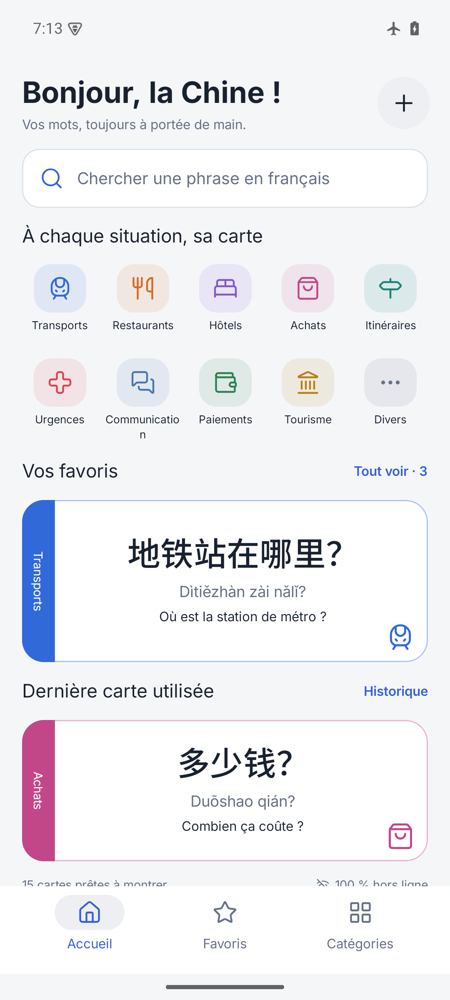
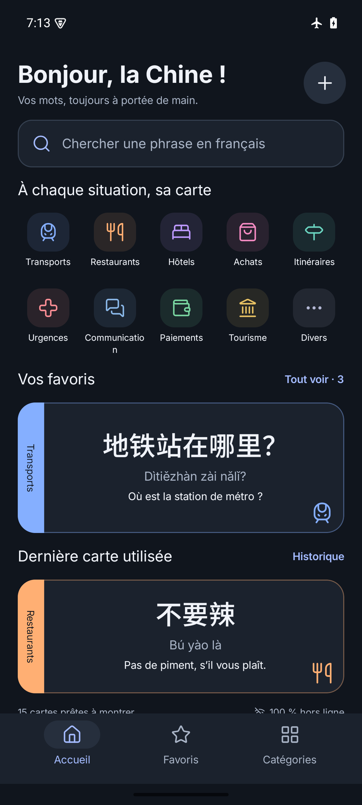
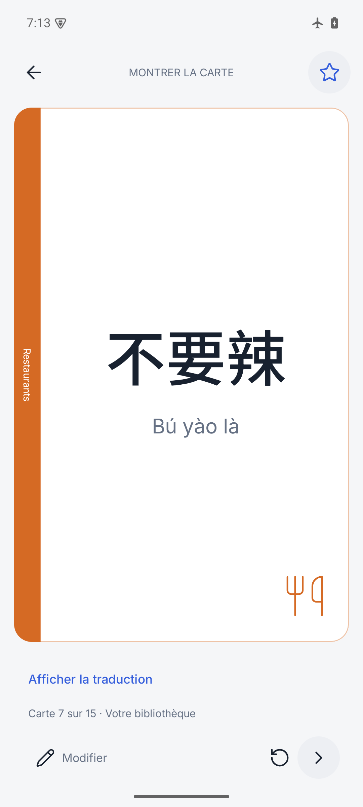

# Shuo · Offline Chinese travel cards

Shuo is an Android phrasebook for French-speaking travelers. Find a phrase, show
it in large simplified Chinese, and keep your own travel cards available offline.
The interface is in French, with tone-marked pinyin and optional English translations.

**Android 8.0+ · Version 0.1.0 · No account or Internet connection required**

| Home · light | Home · dark | Presentation |
| --- | --- | --- |
|  |  |  |

## Features

- Search in French, Chinese, pinyin, English, and keywords, ignoring accents and tones.
- Browse categories, save favorites, and return to recently presented cards.
- Present Chinese and pinyin in large type, reveal translations when needed, or
  rotate a card 180° to show someone across the table. The screen stays awake while presenting.
- Create, edit, and delete phrases; customize category names, order, icons, and colors.
- Choose light, dark, or system appearance and adjust Chinese text size.
- Import and export your library as JSON through Android's file picker.

The starter library contains **15 example phrases in ten categories**. Three cards
start in favorites; history records actual use. The complete, reviewed travel
library is still being developed. New phrases require your own translations;
there is no automatic translation service.

## Install the release APK

Download the signed **[Shuo 0.1.0 APK](https://github.com/tlahitte/Shuo-APK/releases/download/v0.1.0/Shuo-0.1.0-release.apk)**
and its [SHA-256 checksum](https://github.com/tlahitte/Shuo-APK/releases/download/v0.1.0/Shuo-0.1.0-release.apk.sha256)
from [GitHub Releases](https://github.com/tlahitte/Shuo-APK/releases/tag/v0.1.0).
See [release notes](docs/releases/0.1.0.md). On the build machine, release assets are
also available in `dist/`, which is excluded from Git.

1. Copy the APK to an Android 8.0 or newer phone.
2. Open it with the phone's file manager and allow installation from that app when prompted.
3. Launch **Shuo**. All phrasebook features work offline and require no runtime permissions.

With Android platform-tools installed, run from the download directory:

```sh
adb install -r Shuo-0.1.0-release.apk
adb shell am start -n com.shuo.travel/com.shuo.travel.MainActivity
```

The release uses package `com.shuo.travel` and a dedicated release signing key.
The preview (`com.shuo.travel.preview`) can remain installed alongside it and has
separate data. Export from the preview and import into the release to transfer
custom cards. A debug build uses the same package as the release but a different
key; export its data before uninstalling it to install the release.

Source repository: [tlahitte/Shuo-APK](https://github.com/tlahitte/Shuo-APK).
The repository and its releases are private; downloads require an account with
repository access. Signing keys are stored separately and are never uploaded.

## Build from source

Requirements: **JDK 17**, Android SDK platform **35**, build tools **35.0.0**, and
platform-tools. The included wrapper downloads Gradle 8.11.1. Initial dependency
downloads require a network connection; the installed app does not.

Open this folder in Android Studio, or configure the command-line SDK:

1. Set `JAVA_HOME` to JDK 17.
2. Set `ANDROID_HOME` to the Android SDK, or create an untracked `local.properties`
   containing `sdk.dir=/absolute/path/to/android-sdk`.
3. Build a development APK:

```sh
./gradlew :app:assembleDebug
```

The result is `app/build/outputs/apk/debug/app-debug.apk`.

| Variant | Package | Signing | Purpose |
| --- | --- | --- | --- |
| `debug` | `com.shuo.travel` | Android debug key | Development |
| `preview` | `com.shuo.travel.preview` | Android debug key | Optimized, side-by-side preview |
| `release` | `com.shuo.travel` | Dedicated private release key | Distribution |

Build the optimized preview with `./gradlew :app:assemblePreview`.

### Sign a release

Set these environment variables through a private shell file or CI secrets:

| Variable | Value |
| --- | --- |
| `SHUO_KEYSTORE` | Absolute path to the release keystore |
| `SHUO_STORE_PASSWORD` | Keystore password |
| `SHUO_KEY_ALIAS` | Signing key alias |
| `SHUO_KEY_PASSWORD` | Signing key password |

On the original build machine, the private signing file is stored outside the
repository in the sibling `Shuo-APK-signing` directory:

```sh
. ../Shuo-APK-signing/signing.env
./gradlew :app:assembleRelease :app:lintRelease
```

The signed APK is `app/build/outputs/apk/release/app-release.apk`. For Google Play,
`./gradlew :app:bundleRelease` builds an Android App Bundle. Store publication is
separate from building an APK.

Back up the keystore **and its credentials** securely. Reuse the same key and
increase `versionCode` for future updates. Never commit or attach the private
signing directory to a release. The public signing certificate fingerprint is
recorded in the release notes.

## Develop the phrase library

The [starter JSON](app/src/main/assets/starter-library.json) is the editable example.
Exports use the same versioned envelope: `version`, `categories`, and `phrases`.
They include favorites, timestamps, and category metadata. IDs contain letters,
digits, `_`, or `-`; phrase category references must resolve within the file.

The bundled library seeds only once, in a database transaction. Changing the asset
affects **new installations only**; upgrades preserve edits and deleted cards.
Build your library in the app, or export JSON, add cards with new IDs, and import.
Imports skip existing phrase and category IDs, preserving local versions. They do
not overwrite matching cards; edit those cards in the app.

Imports validate the full file before writing, including versions, required text,
IDs, timestamps, colors, icons, and category references. Limits are 5 MiB, 10,000
phrases, and 200 categories. Invalid imports leave the database unchanged.

Data stays on the device. There is no Internet permission, backend, analytics,
account, or broad storage access. Automatic cloud backup and device transfer are
disabled. **Export JSON before uninstalling** or moving to another device.

## Project and validation

Built with Kotlin, Jetpack Compose/Material 3, Navigation Compose, Room, DataStore,
and an MVVM/StateFlow model. The first Room schema is checked in under
[`app/schemas`](app/schemas). Future schema changes require explicit migrations;
destructive migration fallback is disabled.

```sh
./gradlew :app:testDebugUnitTest :app:lintDebug
./gradlew :app:connectedDebugAndroidTest  # running emulator/device required
```

Verification includes 22 local tests and five Android 15 emulator tests covering
search, data validation, CRUD, persistence, favorites, history, rotation, theme
changes, and long text. Additional scenarios cover a small display with 150%
system font size. Reports and screenshots are in
[`docs/verification`](docs/verification); release checks are recorded separately
in the [release notes](docs/releases/0.1.0.md).

Design references and known differences are documented in
[the Figma mapping](docs/figma-mapping.md). Screens without dedicated designs reuse
existing layouts and native controls. Some Figma variants remain unverified after
the provider's quota was reached; full visual parity is not claimed. See the
[implementation status](docs/implementation-status.md) and
[original specification](docs/implementation-plan.md) for details.

Inter, Noto Sans SC, and Lucide attribution and licenses are in
[`docs/licenses`](docs/licenses).
